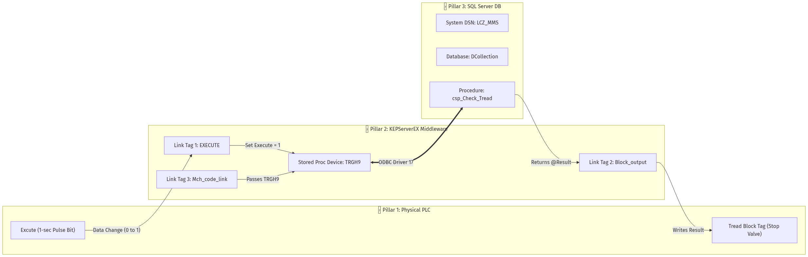
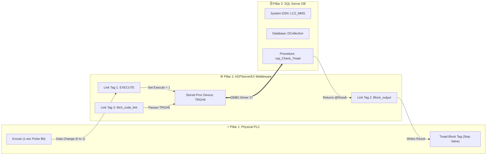
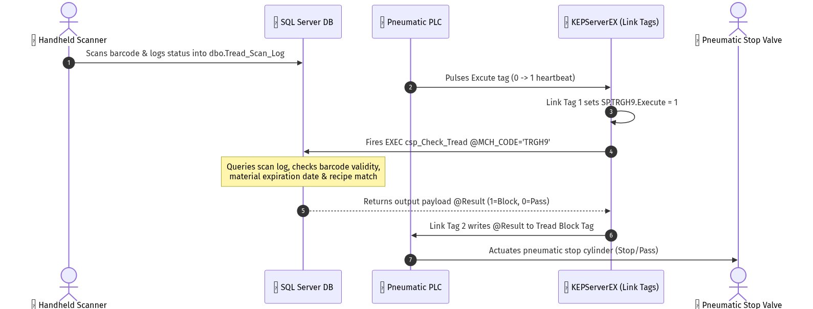
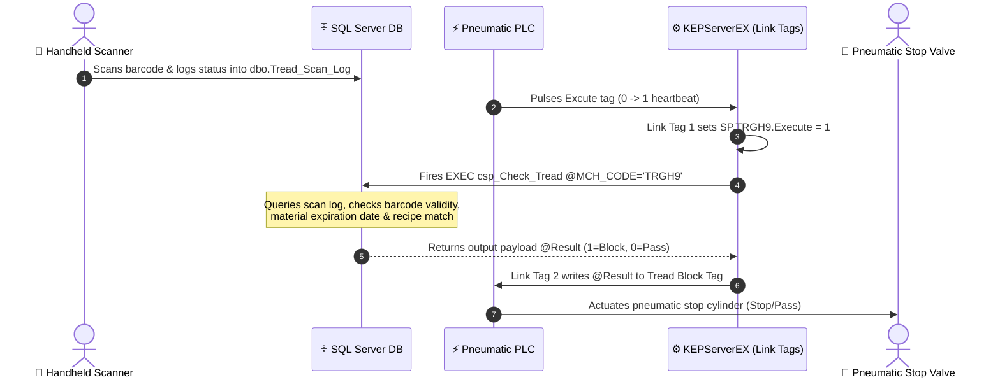

# 🏭 SQL Server – KEPServerEX – PLC Real-Time Quality Interlock Pipeline
**Architecture Blueprint, Closed-Loop Automation & Real-Time Quality Enforcement**

> **System Overview**: End-to-end industrial architecture connecting physical tire-building machines (Siemens S7-1200 / S7-300 / Allen-Bradley) to an enterprise SQL Server database via KEPServerEX 6 and 32-bit ODBC Driver 17. The pipeline physically interlocks pneumatic conveyors to prevent recipe mismatches, expired rubber, or unscanned materials from entering production machines.


---

## ⚙️ KEPServerEX Project Configuration

* **[kepware_tread_interlock_project.json](./kepware_tread_interlock_project.json)**: Ready-to-import KEPServerEX 6 project configuration file. Contains the complete channel configurations (Siemens S7-1200, S7-300, Allen-Bradley ControlLogix, and ODBC Stored Procedure Client), device tags, and _AdvancedTags Link Tag groups (EXECUTE, Block_output_link, Mch_code_link).

# Master Technical Guide: Industrial PLC – KEPServerEX – SQL Server Data Pipeline

## 1. System Architecture & 360-Degree End-to-End Overview

### 1.1 Executive Summary & Core Objective
This document provides complete, 360-degree technical documentation for the bidirectional automated data pipeline connecting physical tire-building machines (**TRGH9**, **TRGC22**, etc.) to an enterprise **SQL Server Database** (`DCollection`) via **KEPServerEX 6** and **Windows System DSN (ODBC)**.

The primary objective of this system is **real-time quality enforcement**: ensuring that physical tread rubber trays fed into tire-building machines are valid, unexpired, and correctly matched to the machine's active production recipe before the pneumatic conveyor allows them to enter the building machine.

---

### 1.2 The Three Core Technological Pillars

| Pillar 1: Physical PLC *(Pneumatic Panel)* | Pillar 2: KEPServerEX Middleware *(ODBC & Advanced Tags)* | Pillar 3: SQL Server Database *(Enterprise Quality DB)* |
| :--- | :--- | :--- |
| • **Pulse Tag:** `Excute` (PLC 1-sec heartbeat `0->1->0->1`) | • **Link Tag 1:** `EXECUTE` (Pulse $\rightarrow$ SQL SP Trigger) | • **Host Server:** `sql-server.plant.local` |
| • **Valve Tag:** `Tread Block Tag` (Stop Solenoid Bit) | • **Link Tag 2:** `Block_output` (SQL Result $\rightarrow$ PLC) | • **Database:** `[DCollection]` |
| • **Protocol:** Industrial Ethernet (Siemens / AB) | • **Derived Tag:** `MCH_CODE_9` (Evaluates `"TRGH9"`) | • **Stored Procedure:** `[dbo].[csp_Check_Tread]` |
| • **Server Host IP:** `192.168.10.50` | • **SP Device:** `SP_Tread_Scanning_SP.TRGH9` | • **System DSN:** `LCZ_MMS` (32-bit ODBC Driver 17) |



<details>
<summary><b>Click to view/edit raw Mermaid code</b></summary>



</details>

#### Pillar 1: The Physical PLC (Programmable Logic Controller)
* **Hardware Scope:** Siemens S7-1200 PLC controlling the pneumatic panel of machine TRGH9 (Driver: Siemens TCP/IP Ethernet, IP `192.168.20.109`).
* **Key Memory Tags:**
  1. `Excute` *(Boolean)*: Electrical Engineer's 1-second pulse bit. Continuously toggles `0 -> 1 -> 0 -> 1` as a heartbeat signal indicating machine readiness.
  2. `Tread Block Tag` *(Boolean)*: PLC output control bit. Wired directly to the physical pneumatic stop valve solenoid (`1` = Energize Stop Cylinder / Block Tray, `0` = De-energize / Allow Pass).

#### Pillar 2: KEPServerEX 6 (The Industrial Middleware Bridge)
* **Connectivity Layer:**
  1. **PLC Channel/Device:** Reads/writes memory addresses directly from physical PLCs (e.g. TRGH9 at IP `192.168.20.109`).
  2. **KEPServer Server Host IP:** `192.168.10.50`.
  3. **ODBC Client Channel (`SP_Tread_Scanning_SP`):** Connects to SQL Server via Windows System DSN `LCZ_MMS`.
* **Stored Procedure Device (`TRGH9` / `TRGC22`):** Wraps SQL Stored Procedure `[dbo].[csp_Check_Tread];1` into 4 active tags:
  * `Execute` *(Internal Boolean Trigger)*: Rising edge `0 -> 1` fires the T-SQL query over ODBC.
  * `input__MCH_CODE` *(String Input)*: Parameter passing machine identifier `'TRGH9'`.
  * `input_output__Result` *(Boolean Output)*: Parameter receiving database evaluation (`1` = Block, `0` = Allow).
  * `output__RETURN_VALUE` *(Long Status)*: Returns SQL execution status (`0` = Success).
* **Advanced Tags Engine:**
  * **Link Tag 1 (`EXECUTE`):** Maps `PLC.Excute` $\rightarrow$ `SP.TRGH9.Execute`. (Link Mode: `On Data Change`, Trigger: `Always`).
  * **Link Tag 2 (`Block_output`):** Maps `SP.TRGH9.input_output__Result` $\rightarrow$ `PLC.Tread Block Tag`. (Link Mode: `On Data Change`, Trigger: `Always`).
  * **Derived Tag (`MCH_CODE_9`):** Evaluates expression `"TRGH9"` and feeds `input__MCH_CODE`.

#### Pillar 3: SQL Server Database (`DCollection`)
* **Host Infrastructure:** `sql-server.plant.local` | Database: `DCollection`.
* **System DSN:** `LCZ_MMS` (32-bit Windows System DSN using ODBC Driver 17 for SQL Server).
* **Stored Procedure `[dbo].[csp_Check_Tread]` Logic:**
  * Receives `@MCH_CODE` string input.
  * Queries the latest scan records logged by handheld scanners in `dbo.Tread_Scan_Log`.
  * Evaluates 4 quality checks: (1) Recent scan present, (2) Barcode valid, (3) Material unexpired, (4) Recipe matched to `@MCH_CODE`.
  * Sets `@Result OUTPUT` = `1` (Block) or `0` (Allow).

---

### 1.3 Complete 360-Degree Data Lifecycle (Chronological Flow)



<details>
<summary><b>Click to view/edit raw Mermaid code</b></summary>



</details>

#### Detailed Phase Breakdown:
1. **Phase 1 (Handheld Scan):** Operator scans tread tray barcode prior to machine entry. Handheld app writes barcode, timestamps, and recipe checks into SQL Server table `Tread_Scan_Log`.
2. **Phase 2 (PLC Heartbeat):** Pneumatic panel PLC toggles `TRGH9.Pneumatic_PLC.Excute` bit from `0` to `1`.
3. **Phase 3 (Link Tag 1 Firing):** KEPServer Link Tag `EXECUTE` sees `Excute` change to `1` and writes `1` to `SP_Tread_Scanning_SP.TRGH9.Execute`.
4. **Phase 4 (ODBC Query Execution):** KEPServer constructs and executes:
   ```sql
   EXEC [dbo].[csp_Check_Tread] @MCH_CODE = N'TRGH9', @Result = @Result OUTPUT
   ```
5. **Phase 5 (Database Execution & Business Rules):** SQL Server runs `csp_Check_Tread` in an isolated session (SPID). It fetches the latest scan for `'TRGH9'`, checks barcode validity, material expiration date, and recipe matching. If valid $\rightarrow$ `@Result = 0`. If invalid/missing $\rightarrow$ `@Result = 1`.
6. **Phase 6 (Result Payload Return):** SQL Server sends `@Result` back over the ODBC pipe. KEPServer updates `SP_Tread_Scanning_SP.TRGH9.input_output__Result`.
7. **Phase 7 (Link Tag 2 Firing):** KEPServer Link Tag `Block_output` detects timestamp update on `input_output__Result` and copies its value (`1` or `0`) to `TRGH9.Pneumatic_PLC.Tread Block Tag`.
8. **Phase 8 (Mechanical Stop/Pass):** Physical PLC receives value. If `1`, pneumatic stop cylinder extends, blocking the tray. If `0`, cylinder retracts, allowing tray into building machine.

---

### 1.4 Multi-Machine Parallel Concurrency
When multiple machines (**TRGH9**, **TRGC22**, **TRGH10**) trigger simultaneously:
* **KEPServer Side:** Manages event triggers asynchronously on separate thread pools.
* **ODBC Side:** Dispatches separate queries (`@MCH_CODE = 'TRGH9'`, `@MCH_CODE = 'TRGC22'`) over the DSN connection pool.
* **SQL Server Side:** Assigns independent Database Sessions (SPIDs) executing in parallel. Because `@MCH_CODE` isolates row lookups, there is **zero data collision, zero cross-talk, and execution finishes in 1–5 milliseconds**.

---

## 2. Step-by-Step Data Lifecycle

1. **Barcode Scan (Handheld Scanner):**
   When a tread tray arrives at the line, an operator uses a handheld barcode scanner. The scanner app writes the scan timestamp, barcode string, expiration status, and recipe validation directly into the SQL Server database (`DCollection`).

2. **Machine Pulse (PLC Heartbeat):**
   The machine PLC continuously toggles a boolean memory bit (`Excute`) between `0 -> 1 -> 0 -> 1` every 1 second as a heartbeat.

3. **Trigger Execution (KEPServer Link Tag 1):**
   KEPServer's Advanced Link Tag (`EXECUTE`) detects the `0 -> 1` transition on `TRGH9.Pneumatic_PLC.Excute` and sets `Tread_Scanning_SP.TRGH9.Execute = 1`.

4. **ODBC Query Execution (KEPServer $\rightarrow$ SQL Server):**
   KEPServer constructs and fires the following ODBC call to SQL Server:
   ```sql
   EXEC [dbo].[csp_Check_Tread] 
        @MCH_CODE = 'TRGH9', 
        @Result = @Result OUTPUT
   ```

5. **Business Logic Evaluation (Inside SQL Server):**
   Inside SQL Server, `[dbo].[csp_Check_Tread]` queries the newest scan record for machine `'TRGH9'` and evaluates rules:
   * Is a recent scan present?
   * Is the barcode valid?
   * Is the material unexpired?
   * Does the material recipe match machine `'TRGH9'`?
   * **Output Calculation:** Returns `@Result = 0` (Allow/Pass) if all rules pass, or `@Result = 1` (Block/Stop) if any rule fails.

6. **Write-Back to Physical PLC (KEPServer Link Tag 2):**
   KEPServer catches `@Result` in tag `SP.TRGH9.input_output__Result`. Link Tag 2 (`Block_output`) immediately writes that `1` or `0` into the PLC tag `TRGH9.Pneumatic_PLC.Tread Block Tag`.

7. **Actuator Operation:**
   The PLC energizes/de-energizes the pneumatic block solenoid valve based on `Tread Block Tag`.

---

## 3. KEPServerEX Stored Procedure Tags Reference

When you add a Stored Procedure Device in KEPServerEX, 4 tags are auto-generated:

| KEPServer Tag Name | Address / Item ID | Data Type | Data Flow Direction | Purpose / T-SQL Mapping |
| :--- | :--- | :--- | :--- | :--- |
| **`Execute`** | `<INTERNALTAG VAR=Execute />` | `Boolean` | Internal KEPServer | **Trigger Bit.** Transition `0 -> 1` executes `EXEC dbo.csp_Check_Tread`. |
| **`input__MCH_CODE`** | `@MCH_CODE` | `String` | KEPServer $\rightarrow$ SQL | **Input Parameter.** Passes machine code string (e.g. `'TRGH9'`) to `@MCH_CODE`. |
| **`input_output__Result`** | `@Result` | `Boolean` | SQL $\rightarrow$ KEPServer | **Output Parameter.** Receives validation result (`1` = Block, `0` = Allow). |
| **`output__RETURN_VALUE`** | `@RETURN_VALUE` | `Long` | SQL $\rightarrow$ KEPServer | **System Status.** Returns `0` for clean SQL execution. |

---

## 4. Advanced Link Tags Configuration

To link PLC tags with Stored Procedure tags, configure the following Advanced Tags:

### Link Tag 1: `EXECUTE` (Pulse Trigger to SQL)
* **Input Tag:** `TRGH9.Pneumatic_PLC.Excute` *(PLC 1-sec pulse bit)*
* **Output Tag:** `SP_Tread_Scanning_SP.TRGH9.Execute`
* **Link Mode:** `On Data Change of Input Tag`
* **Trigger Type:** `Always` *(Ensure Trigger Tag field is blank/cleared)*

### Link Tag 2: `Block_output` (SQL Result to PLC Valve)
* **Input Tag:** `SP_Tread_Scanning_SP.TRGH9.input_output__Result`
* **Output Tag:** `TRGH9.Pneumatic_PLC.Tread Block Tag` *(PLC valve control bit)*
* **Link Mode:** `On Data Change of Input Tag`
* **Trigger Type:** `Always`

### Machine Code Enforcement Options (Setting `input__MCH_CODE`)
* **Option A (Derived Tag + Link Tag - Standard & Fail-Safe):**
  1. Create Derived Tag `_AdvancedTags.BU_MCH_NAMES.MCH_CODE_9` of type `String` with expression `"TRGH9"`.
  2. Create Link Tag `Mch_code_link`: Input = `_AdvancedTags.BU_MCH_NAMES.MCH_CODE_9` $\rightarrow$ Output = `SP_Tread_Scanning_SP.TRGH9.input__MCH_CODE`.
  3. **Link Mode:** Set to **`On Interval`** with **Link Rate = `1000 ms` (1 second)**.
     * *Note:* Setting `Link Mode = On Interval` ensures that even if the ODBC driver re-initializes or resets stored procedure parameter tags, `input__MCH_CODE` is continuously refreshed and will **never remain NULL**.
* **Option B (Direct Default Value):**
  Double-click `SP_Tread_Scanning_SP.TRGH9.input__MCH_CODE` tag and set its static initial default value to `"TRGH9"`.

---

## 5. SQL Server Mechanics & Concurrency

### How Multi-Machine Execution Works
If two machines (**TRGH9** and **TRGC22**) trigger at the exact same millisecond:
1. KEPServer handles both triggers asynchronously.
2. KEPServer dispatches two separate ODBC queries:
   * Query 1: `EXEC csp_Check_Tread @MCH_CODE = 'TRGH9', @Result = @Result OUTPUT`
   * Query 2: `EXEC csp_Check_Tread @MCH_CODE = 'TRGC22', @Result = @Result OUTPUT`
3. SQL Server executes both requests in **separate, isolated database sessions (SPIDs)** in parallel.
4. Because `@MCH_CODE` is different, each query checks distinct database rows. There is **zero data collision or cross-talk**.
5. Both results return in 1–5 milliseconds to their respective tags.

---

## 6. Complete Guide: How to Expand to New Machines (e.g., TRGC22, TRGH10)

Follow these exact steps whenever adding a new machine to the pipeline:

### Step 1: Configure Windows System DSN (One-Time Setup)
*(Skip if DSN `LCZ_MMS` is already created)*
1. Open **ODBC Data Sources (32-bit)** on the Windows host server.
2. Under **System DSN**, click **Add** $\rightarrow$ **ODBC Driver 17 for SQL Server**.
3. DSN Name: `LCZ_MMS` | Server: `sql-server.plant.local` | Database: `DCollection`.

### Step 2: Add Stored Procedure Device in KEPServerEX
1. Under channel `SP_Tread_Scanning_SP`, right-click $\rightarrow$ **New Device**.
2. Device Name: Enter machine name (e.g. `TRGC22` or `TRGH10`).
3. Driver: `ODBC Client` | Model: `Generic`.
4. In **Stored Procedure Selection**, select `csp_Check_Tread;1`.
5. Set `Clear Inputs After Each Execution = Disable`, `Reinitialize Stored Procedure = Enable`.
6. Click **Update Tags...** to generate the 4 parameter tags.

### Step 3: Set Machine Code for the New Machine
* **Using Derived Tag:**
  1. Under `_AdvancedTags.BU_MCH_NAMES`, add Derived Tag (e.g. `MCH_CODE_TRGC22`) with expression `"TRGC22"`.
  2. Create Link Tag: Input = `_AdvancedTags.BU_MCH_NAMES.MCH_CODE_TRGC22` $\rightarrow$ Output = `SP_Tread_Scanning_SP.TRGC22.input__MCH_CODE`.
* **OR Using Static Default:**
  Double-click `SP_Tread_Scanning_SP.TRGC22.input__MCH_CODE` and set static initial value to `"TRGC22"`.

### Step 4: Add Machine PLC Device & Tags
1. Under your PLC channel (or create a new PLC channel if on a different IP), add device e.g. `TRGC22.Pneumatic_PLC`.
2. Add PLC tags:
   * `Excute` (Boolean) $\rightarrow$ Address for 1-second pulse bit.
   * `Tread Block Tag` (Boolean) $\rightarrow$ Address for physical block valve solenoid.

### Step 5: Add Advanced Link Tags for the New Machine
Under **Advanced Tags**, create 2 Link Tags:

1. **`EXECUTE_TRGC22`**:
   * Input: `TRGC22.Pneumatic_PLC.Excute`
   * Output: `SP_Tread_Scanning_SP.TRGC22.Execute`
   * Link Mode: `On Data Change of Input Tag` | Trigger Type: `Always`
2. **`Block_output_TRGC22`**:
   * Input: `SP_Tread_Scanning_SP.TRGC22.input_output__Result`
   * Output: `TRGC22.Pneumatic_PLC.Tread Block Tag`
   * Link Mode: `On Data Change of Input Tag` | Trigger Type: `Always`

### Step 6: Verification in OPC Quick Client
1. Launch **Tools $\rightarrow$ OPC Quick Client**.
2. Check `TRGC22.Pneumatic_PLC.Excute`: Verify it toggles `0` and `1` every second.
3. Check `SP_Tread_Scanning_SP.TRGC22.Execute`: Verify it toggles in sync.
4. Check `SP_Tread_Scanning_SP.TRGC22.input_output__Result`: Verify timestamp updates every second with result (`1` or `0`).
5. Check `TRGC22.Pneumatic_PLC.Tread Block Tag`: Confirm value matches `input_output__Result`.

---

## 7. Target Machine Inventory Matrix

The following table documents all plant machine codes designated for integration into the Tread Verification Pipeline:

| Machine Family | Total Count | Machine Code Identifiers |
| :--- | :--- | :--- |
| **TRGB Series** | 6 | `TRGB1`, `TRGB2`, `TRGB3`, `TRGB4`, `TRGB5`, `TRGB6` |
| **TRGC Series** | 10 | `TRGC13`, `TRGC14`, `TRGC15`, `TRGC16`, `TRGC17`, `TRGC18`, `TRGC22`, `TRGC23`, `TRGC24`, `TRGC25` |
| **TRGD Series** | 5 | `TRGD10`, `TRGD11`, `TRGD12`, `TRGD19`, `TRGD20` |
| **TRGH Series** | 3 | `TRGH7`, `TRGH8`, `TRGH9` |
| **System / Auxiliary** | 2 | `RM301`, `MES1` |


